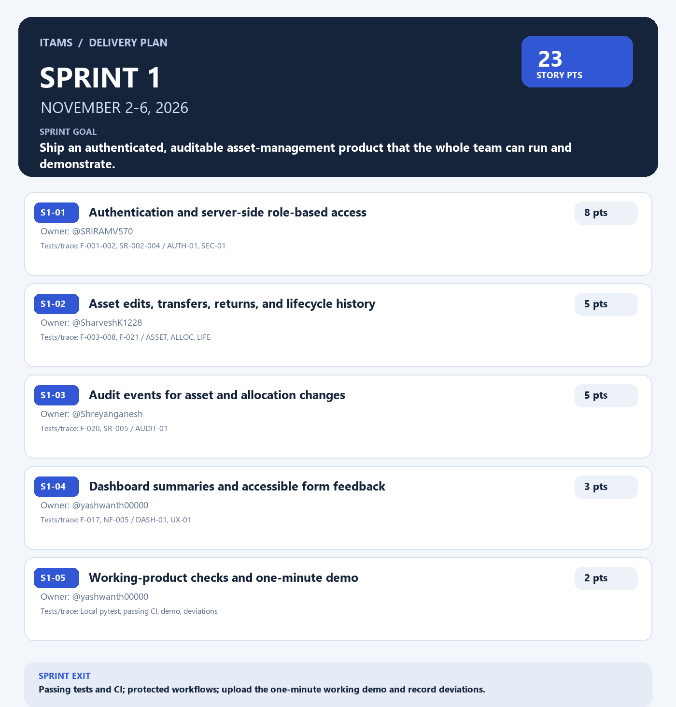
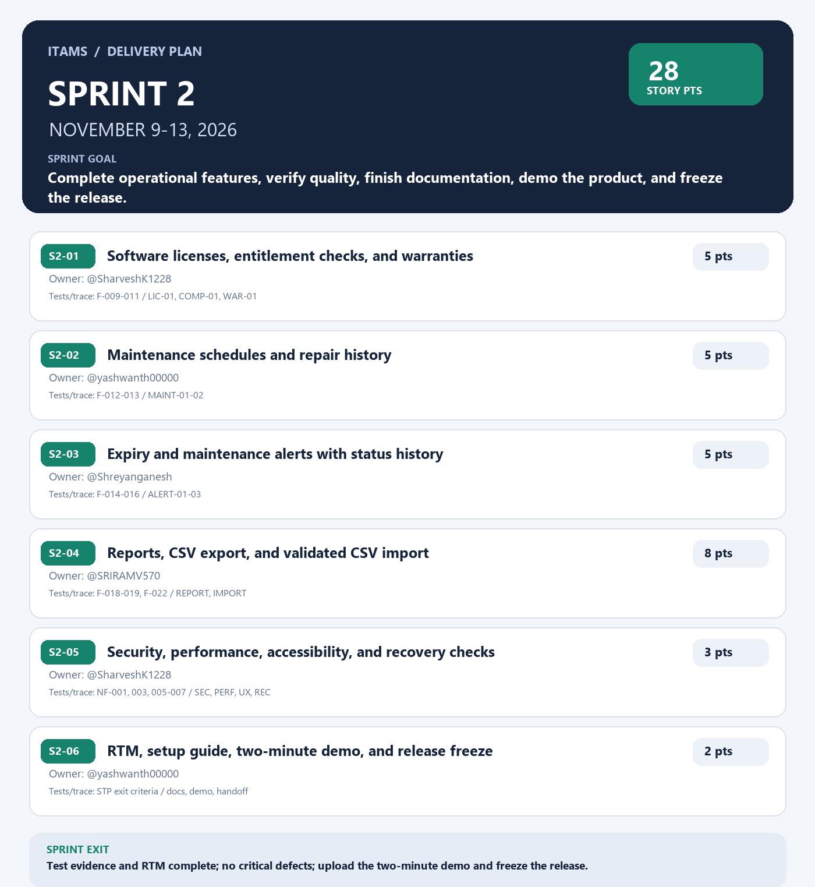

# ITAMS sprint plan

This plan turns the submitted SRS, SAD, Test Plan, and the course deliverables sheet into a two-sprint backlog. The date ranges have been rolled forward, as requested.

## Team

| GitHub username | Responsibility |
|---|---|
| [SRIRAMV570](https://github.com/SRIRAMV570) | Authentication foundation, reports/import-export |
| [SharveshK1228](https://github.com/SharveshK1228) | Asset lifecycle, license/warranty, quality checks |
| [Shreyanganesh](https://github.com/Shreyanganesh) | Audit trail, alerts |
| [yashwanth00000](https://github.com/yashwanth00000) | Dashboard/usability, maintenance, sprint demos and handoff |

Story points use the Fibonacci scale. These are planning estimates, not measured individual capacity. Each implementation item must be developed on its own feature branch, include focused automated tests, be tested locally, and reach `main` only through a PR with a teammate's approval and passing CI.

## Existing work to bring into the project

The asset-inventory MVP and GitHub Actions pytest workflow are already pushed to `feature/ci-tests` (which includes `feature/asset-inventory-mvp`). Before Sprint 1 starts, open one PR from `feature/ci-tests` to `main`, have a teammate review it, confirm CI passes, and merge it. This provides the team a common baseline; do not copy these features into new backlog cards.

## Sprint 1 — Working product

**Dates:** November 2–6, 2026
**Goal:** Deliver a protected, auditable asset-management product that the team can run and demonstrate.
**Total:** 23 points

| ID | Backlog item | Points | Owner | SRS / test references |
|---|---|---:|---|---|
| S1-01 | Add authentication and server-side role-based access | 8 | [SRIRAMV570](https://github.com/SRIRAMV570) | ITAM-F-001–002, ITAM-SR-002–004; TC-AUTH-01, TC-SEC-01 |
| S1-02 | Complete asset editing, reassignment, transfer, and lifecycle history | 5 | [SharveshK1228](https://github.com/SharveshK1228) | ITAM-F-003–008, ITAM-F-021; TC-ASSET-01–03, TC-ALLOC-01–02, TC-LIFE-01 |
| S1-03 | Record audit events for important asset and allocation changes | 5 | [Shreyanganesh](https://github.com/Shreyanganesh) | ITAM-F-020, ITAM-SR-005; TC-AUDIT-01 |
| S1-04 | Improve dashboard summaries and keyboard-accessible form feedback | 3 | [yashwanth00000](https://github.com/yashwanth00000) | ITAM-F-017, ITAM-NF-005; TC-DASH-01, TC-UX-01 |
| S1-05 | Validate the working increment and prepare the one-minute sprint demo | 2 | [yashwanth00000](https://github.com/yashwanth00000) | STP acceptance/exit criteria; local test run, CI run, demo and deviation notes |

### Sprint 1 acceptance

- Users must authenticate before protected routes are available; server-side role checks deny unauthorized actions.
- Passwords are stored as salted hashes; tests verify that raw passwords and session credentials are not logged.
- Asset edits, transfers, returns, and retirement preserve prior history and reject invalid state changes.
- Critical changes include actor, timestamp, action, and target in the audit history.
- Dashboard totals match the test database; forms can be completed using the keyboard and show clear validation.
- `python -m pytest -q` passes locally and the PR check passes on GitHub Actions.
- Record a one-minute video of the working product, upload it to the repository, and document deviations from the submitted SRS/SAD/Test Plan.

## Sprint 2 — Complete, document, demo, and freeze

**Dates:** November 9–13, 2026
**Goal:** Complete the high-priority operational features, verify quality, finish documentation, and freeze a reproducible demo build.
**Total:** 28 points

| ID | Backlog item | Points | Owner | SRS / test references |
|---|---|---:|---|---|
| S2-01 | Track software licenses, entitlement compliance, and warranties | 5 | [SharveshK1228](https://github.com/SharveshK1228) | ITAM-F-009–011; TC-LIC-01, TC-COMP-01, TC-WAR-01 |
| S2-02 | Schedule maintenance and preserve service history | 5 | [yashwanth00000](https://github.com/yashwanth00000) | ITAM-F-012–013; TC-MAINT-01–02 |
| S2-03 | Generate, acknowledge, assign, and resolve expiry and maintenance alerts | 5 | [Shreyanganesh](https://github.com/Shreyanganesh) | ITAM-F-014–016; TC-ALERT-01–03 |
| S2-04 | Add inventory reports, CSV export, and validated CSV import | 8 | [SRIRAMV570](https://github.com/SRIRAMV570) | ITAM-F-018–019, ITAM-F-022; TC-REPORT-01–02, TC-IMPORT-01 |
| S2-05 | Run security, performance, compatibility, and backup/restore regression checks | 3 | [SharveshK1228](https://github.com/SharveshK1228) | ITAM-NF-001, 003, 005–007; ITAM-SR-001–006; TC-SEC-02–06, TC-PERF-01, TC-UX-01, TC-REC-01 |
| S2-06 | Finish the RTM and setup guide, record the two-minute demo, and freeze the release | 2 | [yashwanth00000](https://github.com/yashwanth00000) | STP exit criteria; updated requirement/test status, demo video, tagged/frozen build |

### Sprint 2 acceptance

- License/warranty and maintenance records validate input and are linked to assets; excess license usage and due events are surfaced correctly.
- Alerts are not duplicated on repeated generation and their status transitions retain history.
- Reports/exports match source records and filters; CSV import reports row-level errors without silently discarding data.
- The test plan is executed or explicitly deferred; no critical defect or unresolved privilege-escalation/data-loss issue remains.
- Update the requirements traceability matrix with implementation and test status; document setup, known limitations, and backup/restore.
- Record and upload the two-minute working-product demo, then freeze feature development. Any later fix needs explicit team approval and a targeted test.

## Definition of done for every feature

1. Implement the feature on a separate `feature/...` branch.
2. Add/update an automated test for its acceptance criteria.
3. Run `python -m pytest -q` locally before pushing.
4. Open a PR to `main` and request review from at least one teammate.
5. Merge only after approval and passing GitHub Actions checks.
6. Pull the latest `main` after a merge before starting the next feature.

## GitHub Project setup checklist

Create a repository-linked GitHub Project named **ITAMS Delivery Plan** and add fields:

- **Status:** Backlog, Ready, In Progress, In Review, Done
- **Sprint:** Sprint 1 (Nov 2–6), Sprint 2 (Nov 9–13)
- **Story points:** Number
- **Priority:** P0, P1, P2

Create the two sprint milestones using the dates above, then create one issue per backlog row, set its assignee, milestone, sprint, and points, and place it in the Project. Start by adding S1-01 through S1-05 to Sprint 1 and S2-01 through S2-06 to Sprint 2. Add the image files below to the Project/README for quick reference.

> GitHub issue, milestone, and Project write operations are not available in the connected GitHub tools for this session. This committed plan is ready to copy into the repository's Project; the checklist above distinguishes that from work that has actually been created in GitHub.
